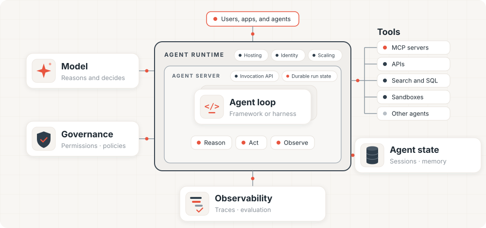

# Databricks Agent Development Platform




A repository of custom agents built on [Agent Bricks.](https://github.com/databricks/databricks-ai-bridge/tree/main/integrations/agentbricks)

Agent Bricks is the Databricks agent developer platform. Use it to build and deploy the agents that power your agentic products and workflows. Agent Bricks is built for developers who write code. You bring an agent built with any framework or harness and choose any model. They can be deployed either locally or as as Databricks Apps. 

One directory per agent, each self-contained: its own `pyproject.toml`, its own `agent.toml`, its own docs, deployable on its own.

## Projects

| Project                           | Showcases                                                                                                                                                                | Tags                                                                                                | Start here                                                                        |
| --------------------------------- | ------------------------------------------------------------------------------------------------------------------------------------------------------------------------ | --------------------------------------------------------------------------------------------------- | --------------------------------------------------------------------------------- |
| [research-agent](research-agent/) | **Planning** — writes a todo list, works the list, then synthesises. Showcases running a LangGraph Deep Agent on Agent Bricks. Deploy local and on Databricks workspace. | `langgraph` `deep-agents` `planning` `human-in-the-loop` `mcp` `memory` `sessions` `mlflow-tracing` | [README](research-agent/README.md) · [study guide](research-agent/study_guide.md) |
| [insights-agent](insights-agent/) | **Structured + unstructured on one question** — Genie for sales numbers, Vector Search for customer reviews, with charts and tables in the chat. Deploy-only.            | `openai` `genie` `vector-search` `mcp` `human-in-the-loop` `sessions` `memory` `mlflow-tracing`     | [README](insights-agent/README.md)                                                |

Each row above is a one-line summary on purpose. How an agent is built, what to ask it, and how to  
verify it all live in that project's own README.

## What each project looks like

Agent directories follow the same layout, so the docs are in the same place each time. The first
four are always present; the two marked *optional* appear once a project has grown enough to need
them, and `research-agent` is the one that has:

| File | Owns |
| --- | --- |
| `README.md` | The demo script. Start here. |
| `AGENTS.md` | Development map for coding agents. `CLAUDE.md` is a one-line include of it |
| `AGENTKIT_CONTRACT.md` | Managed-runtime integration requirements |
| `CHAT_APP.md` | The browser chat overlay |
| `study_guide.md` | *Optional* — the code reading path: concepts, request lifecycle, what to read in order |
| `REFERENCE.md` | *Optional* — the HTTP API, recovery semantics, architecture; what a demo does not need |

Code sits under `agent/` (the framework-native agent, its prompt and its tools) and `runtime/` (the
managed-runtime adapter and server). That split is deliberate: `agent/` has no dependency on Agent
Bricks request types, so it can be driven from a notebook or a test.

## Getting started

Each project is independent — there is no root build. Pick one and follow its README:

```bash
cd research-agent
uv sync
agentbricks dev          # http://localhost:8000, chat app included
uv run pytest            # hermetic; no workspace needed
```

Deploying needs a Databricks workspace profile:

```bash
databricks auth login --profile <name>
agentbricks --profile <name> deploy
```

## Adding a project

Scaffold it rather than copying an existing directory, then add a row to the table above:

```bash
agentbricks init <name> --framework langgraph # or openai
```

`agentbricks init --help` lists the available frameworks and templates. To bring an agent that
already exists, run `agentbricks init --framework <f> --existing .` inside it to generate a
migration prompt for a coding agent, working against that project's `AGENTKIT_CONTRACT.md`.

## License

[Apache 2.0](LICENSE).
